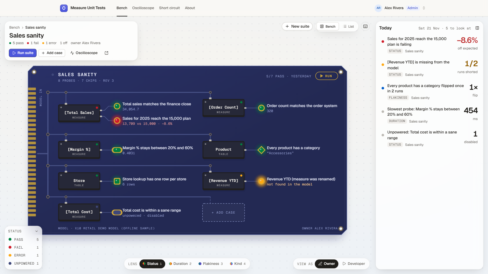

# Measure Unit Tests

Regression tests for DAX measures. A team stores the expected values of the measures that matter, runs them against a
Power BI / Fabric semantic model after every change, and sees pass or fail with the actual value next to the expected
one, plus a history of the pass rate. Built as a Fabric App (Rayfin 2.0): a Fabric SQL database holds suites, cases and
results; the semantic model is queried through the Rayfin semantic model connector as the signed-in user.



## What it looks like

**The test bench.** Each suite is a circuit board, each measure (or table) a case queries is a chip, and each case is
a probe soldered to it; Run suite sends current from the model connector along the traces, and probes light green
(pass), red (fail, with the gap) or amber (error) one by one as results stream in.

- **Lenses** (keys 1–4) repaint the same probes by **status**, **duration** (relative to the fastest and slowest probe),
  **flakiness** (pass/fail flips across runs) and **kind** (each kind also has its own pad shape: scalar dot, between
  capsule, row count square, not blank diamond).
- **Today** ranks the failing probe (with its gap), short circuits, the flakiest and slowest probes and unpowered ones;
  each item flies the camera to its probe and opens its readout. **View as** owner or developer previews what a
  run-only teammate sees.
- **Tools:** the **Oscilloscope** (pass rate per run on channel A, plus one square-wave channel per probe), the
  **Probe** (add or edit a case, with a live reading as you type), and **Short circuit** (every error explained, with
  the model's own message and the fix).
- **Fallbacks:** the bench is SVG, so it needs no WebGL (`?nowebgl` renders the same board); a List view shows the same
  probes as a table; reduced motion turns off camera flights and the current animation. Press `?` for shortcuts.

More screenshots (1280 and 390 px, light and dark): [docs/redesign/](docs/redesign/).

Demo video (about 2 minutes, AI-generated narration, captions burned in): [demo/out/measure-unit-tests.mp4](demo/out/measure-unit-tests.mp4) · captions file [demo/out/measure-unit-tests.srt](demo/out/measure-unit-tests.srt). Re-record with `npx tsx tools/demo/record.ts measure-unit-tests` from the repo root.

## 1. Prerequisites

- Microsoft Fabric with the **Fabric Apps** workload enabled, and a workspace on a Fabric capacity where you have
  **Edit** permission (Contributor or above).
- A semantic model in a workspace your users can read. The app ships bound to a model named "X10 Retail Demo Model".
- Tenant setting **Semantic Model Execute Queries REST API** turned on (Admin portal, Integration settings). The
  connector runs DAX through this API.
- Every user who runs tests needs **Build** permission (plus Read) on the semantic model, because queries run under
  their own identity. Without it a case ends as an error with category `api`.
- Users need access to the app item (workspace members get it by default).
- Node 20 or later.

## 2. Run locally

```bash
npm install                 # once, at the repo root
cd apps/measure-unit-tests
npm run dev                 # offline demo on http://localhost:5201
```

`npm run dev` is the offline demo: an in-memory store seeded with sample data (kept in your browser), an offline mock of
the retail model that answers the sample queries in 0.45 to 1.35 s each (so a run visibly streams), and a persona switcher in the identity menu (Alex
Rivera: admin and suite owner; Sam Taylor: BI developer who can run but not edit). Open `?as=demo-user` to start as Sam.
"Reset demo data" in the identity menu re-seeds.

`npm run dev:fabric` runs `rayfin dev` against Fabric. Connectors do not run under `rayfin dev`, so test queries there
return an error; deploy to exercise the model.

Tests: `npx vitest run` (unit) and `npx playwright test` (e2e at 390 px and 1280 px, offline).

## 3. Deploy

The connector entry in `rayfin/rayfin.yml` reads the semantic model's ids from the environment
(`workspaceId: ${MODEL_WORKSPACE_ID}`, `itemId: ${MODEL_ITEM_ID}`), so no GUIDs are committed. Set both when you deploy:

```bash
npx rayfin login
MODEL_WORKSPACE_ID=<model workspace id> MODEL_ITEM_ID=<semantic model id> npx rayfin up --workspace-id <app workspace id>
```

In PowerShell, set `$env:MODEL_WORKSPACE_ID` and `$env:MODEL_ITEM_ID` first. From the repo root the deploy helper does the
same with an Azure CLI sign-in:

```bash
node tools/deploy-app.mjs measure-unit-tests --workspace-id <app workspace id> --model-workspace-id <model workspace id> --model-item-id <semantic model id>
```

`rayfin up` builds the app (`build:fabric`), creates the app backend and SQL database, applies the schema (including
later schema changes), applies the connector configuration and uploads the site. The model ids are resolved at deploy
time and injected server-side; they are not part of the browser bundle.

## 4. Seed (optional)

```bash
# from the repo root (or `npm run seed:fabric -- --admin-email you@yourorg.com` in the app folder)
node tools/seed-fabric.mjs --app measure-unit-tests --admin-email you@yourorg.com
```

Open the deployed app once first so your Person row exists. The seed inserts one suite, **Sales sanity**, with 8 cases
(one per kind; one deliberately failing: Sales for 2025 expected at 15,000; one deliberately erroring: the unknown
measure `[Revenue YTD]`; one disabled), three past runs (finished, cancelled, finished) with 17 results, and the demo
Person rows. It is idempotent (marker `seed:v1`) and never runs on its own. Against the X10 Retail Demo Model, Run suite
gives **5 pass, 1 fail, 1 error, 1 disabled**. All expected values live in `SEED_EXPECTED` in `src/seed.ts`.

With `--admin-email`, the script maps the first persona (Alex Rivera, `demo-admin`) to your Person row: you become the
owner of the seeded suite and its cases (`createdBy`, `ownerSub` and the owner and starter names are rewritten to you),
and your row gets `isAdmin = 1`. The equivalent manual SQL for the admin flag:

```sql
UPDATE dbo.People SET isAdmin = 1 WHERE email = 'you@yourorg.com';
```

If you seeded without `--admin-email`, the suite still belongs to `demo-admin` and the database lets nobody edit its
cases (anyone can still run it). To take it over afterwards:

```sql
DECLARE @me nvarchar(255) = (SELECT TOP 1 sub FROM dbo.People WHERE email = 'you@yourorg.com');
UPDATE dbo.TestSuites SET createdBy = @me WHERE createdBy = 'demo-admin';
UPDATE dbo.TestCases SET ownerSub = @me WHERE ownerSub = 'demo-admin';
```

## 5. Rebind to another model

The connector is named `model` and only allows the `executeQuery` operation. To point the app at another semantic model:

```bash
npx rayfin connector remove model
npx rayfin connector add --type fabric-semanticmodel --workspace-id <ws> --item-id <model> --name model --operations executeQuery
```

`connector add` needs literal ids (it checks the item), so it writes them into `rayfin/rayfin.yml`. Before you commit,
put the placeholders back in the `model` entry so no GUIDs are committed:

```yaml
    config:
      workspaceId: ${MODEL_WORKSPACE_ID}
      itemId: ${MODEL_ITEM_ID}
```

Then deploy with the new ids in `MODEL_WORKSPACE_ID` and `MODEL_ITEM_ID` (see Deploy). Edit the seed DAX too: the
measure and table names in `SEED_DAX` and the numbers in `SEED_EXPECTED` (`src/seed.ts`), and the model label
`MODEL_LABEL` in `src/config.ts`. Existing cases are just DAX text: open each one in the case drawer and adjust it, or
run the suite and fix whatever errors with "cannot be determined". The model ids are injected server-side and never
reach the browser bundle.

## 6. How it works

### Screens

| Screen | What it does |
|---|---|
| Bench (`/`) | Every suite as a circuit board (SVG, `src/bench/`). Lenses, Today, view as, a readout for the focused probe, Run on the board with a live run monitor, the empty socket that adds a case, and a List view of the same probes. Drag to pan and wheel to zoom on desktop. |
| Board (`/suites/:id`) | The suite's board close up and its cases table (probe, chip, kind, expected, last status, last actual, duration, enabled switch). Run suite, Run selected, Add case, Edit and Delete suite. |
| Probe (drawer) | Add or edit a case. **Measure** mode: `[Total Sales]` + `'Date'[Year] = 2025` becomes `EVALUATE ROW("v", CALCULATE([Total Sales], 'Date'[Year] = 2025))` and takes a live reading once the query settles. **Raw DAX** mode: any query starting with EVALUATE or DEFINE. Both have **Test query** and **Use this value as expected**. |
| Run results (`/runs/:id`) | The board lit with this run's readings (live while it runs), pass / fail / error / disabled counts, an LED progress strip, Cancel, Run again, a status filter and a grid of expected versus actual with the gap, message and duration. Polls every 5 s while someone else's run is in progress. |
| Oscilloscope (`/suites/:id/history`, `/scope`) | Channel A traces the pass rate of the last 30 runs (click a point to open the run); one channel per probe shows pass high, fail low, error as noise and gaps where the case was not run, with its flip count. `?case=<id>` highlights one channel. A table of runs below. |
| Short circuit (`/shorts`) | Every enabled probe whose last reading was an error: the cause in plain words (`src/domain/shorts.ts`), the model's own message, the fix, Open probe and Show on bench. A guide to every kind of short. |
| About (`/about`) | The metaphor, rules and limits from `src/config.ts`. |

### Entities (`rayfin/data/`)

| Entity (table) | Fields | Notes |
|---|---|---|
| TestSuite (`TestSuites`) | name (3–80), description (≤500, optional), createdBy (sub), createdByName, createdAt | |
| TestCase (`TestCases`) | suiteId, name (3–120), kind (`scalar`/`rowcount`/`notblank`/`between`), dax (≤4000), expected (≤200), tolerance (≤40), tags (≤200, comma list), enabled, ownerSub, createdAt, updatedAt | `ownerSub` is the suite owner's sub, copied for the row policy. |
| TestRun (`TestRuns`) | suiteId, startedAt, finishedAt, startedBy (sub), startedByName, status (`running`/`done`/`cancelled`), caseCount, disabledCount, passCount, failCount, errorCount | |
| TestResult (`TestResults`) | runId, suiteId, caseId, caseName, kind, status (`pass`/`fail`/`error`), expected, actual (≤400), message (≤1000), durationMs, startedBy, createdAt | Case name, kind and expected are snapshots, so history survives edits. |
| Person, AppMarker | shared identity and seed marker | unchanged from the scaffold |

### Comparators (`src/domain/compare.ts`)

- **Scalar**: the first cell of the first row equals Expected. Numbers compare within the tolerance: absolute (`0.01`)
  or percent of Expected (`0.5%`); default `0.000001` for floating-point noise. Anything else compares as exact text.
- **Row count**: the number of rows equals Expected (a whole number; 0 is valid).
- **Not blank**: the first cell is not blank, null or an empty string.
- **Between**: the first cell is a number within `low..high`, inclusive (`0.2..0.6` or `20%..60%`).
- Thousands separators, currency symbols and codes are stripped first; `(120)` is −120, `45%` is 0.45.
- Zero rows is an error with message `no rows` (except Row count). A connector failure is an error whose message is
  `<category>: <message>`. Nothing throws.

### Run engine (`src/domain/runner.ts`)

Enabled cases (or the selected ones) run 2 at a time with a 30 s timeout each. The TestRun row is written first, then
one TestResult per case as each completes, then the counts and finish time. Cancel stops the queued cases; cases already
running finish and are recorded, and the run is marked cancelled. Queries carry `resultSetRowCountLimit` (1,000 rows, or
50,000 for Row count), so a runaway query fails as `overflow` instead of downloading a table. Previews show 100 rows.
Two people can run the same suite at once: each run is its own row.

The model client sits behind one React context (`src/model-client.tsx`): the Rayfin connector
(`client.connectors.model.executeQuery`, wrapped by `connectorModelClient`) in Fabric, the offline `MockModelClient`
(`src/mock-model.ts`) in demo mode, Vitest and Playwright. Components never know which one they have.

### Security model

| Entity | Read | Create | Update | Delete |
|---|---|---|---|---|
| TestSuite | everyone signed in | own rows only (`createdBy = sub`) | owner only; `createdBy`, `createdAt` excluded | owner only |
| TestCase | everyone signed in | `ownerSub = sub` | `ownerSub = sub`; `ownerSub`, `suiteId`, `createdAt` excluded | `ownerSub = sub` |
| TestRun | everyone signed in | `startedBy = sub` | `startedBy = sub`; `startedBy`, `suiteId`, `startedAt` excluded | nobody |
| TestResult | everyone signed in | `startedBy = sub` | nobody | nobody |
| Person | everyone signed in | own row, `isAdmin` excluded | own row, `isAdmin` and `sub` excluded | nobody |

Enforced in the domain functions (both modes): only the suite owner or an admin edits a suite or its cases; a case is
always created with the suite owner's sub; runs only include enabled cases. The UI hides edit controls from everyone
else and opens the case drawer read-only (Test query still works).

## 7. VERIFY outcomes and known limits

VERIFY outcomes (see also `shared/NOTES.md`):

- Hybrid project (SQL entities + connector): supported. `rayfin.yml` carries `services.data` and a `connectors:` entry
  `model` (`fabric-semanticmodel`, `executeQuery` only); the client registers `connectorsService` with the generated
  `connectorConfig` and the `fabricSemanticModel()` runtime next to the data service.
- Connector result: column-aligned `{ status, table: { columns, rows } }` or `{ status: 'error', error: { category,
  message } }`; the app always checks `status` and turns every failure into an error result.
- Row caps: `resultSetRowCountLimit` is honoured and exceeding it returns category `overflow`.
- Seed values were taken from the bound X10 Retail Demo Model by DAX ([Total Sales] 34054.7, [Order Count] 320,
  [Margin %] 0.403, Store 6 rows, Sales for 2025 13709).
- Verified live on 20 Nov 2026: the deployed app ran the Sales sanity suite through the connector as the signed-in
  user (5 pass, 1 fail on the 2025 plan by -8.61%, 1 error for the renamed measure, 13.7 s). Connectors do not run
  under `rayfin dev`, so check this once after every `rayfin up`.

Known limits:

- **No admin claim for row policies.** Admin rights are enforced in the domain code only. The database policies let only
  the suite owner change a suite or its cases, so in a deployed app an admin's edit of someone else's suite is refused
  with a permission error. Workaround: transfer ownership with SQL (see Seed). Proper fix: dynamic auth claims (Later).
- **Cross-row rules are not expressible in the policy DSL.** Through the GraphQL API a signed-in user could add a case
  to someone else's suite (with their own sub as `ownerSub`), or write run and result rows for any suite under their
  own sub. They cannot change or delete anyone else's rows. The app never does this; treat results as trustworthy only
  from people you trust with the workspace.
- Runs execute in the browser. Closing the tab mid-run leaves the run "running"; after 10 minutes it shows as
  Interrupted. Cancel does not abort queries already in flight (each is bounded by the 30 s timeout).
- Deleting a suite deletes its cases; its runs and results stay in the database (insert-only history) but are no longer
  listed.
- The Fabric build embeds the Rayfin API URL (which contains the tenant and workspace ids) and the publishable key in
  the JavaScript bundle, as every Rayfin app does. Neither is a secret: the publishable key is designed for client
  code, and every request still needs a signed-in Fabric user. The semantic model ids are not in the bundle.
- Measure mode handles one measure plus one CALCULATE filter expression; anything richer goes in Raw DAX.
- Number parsing treats comma as a thousands separator (not a decimal comma).

## 8. Later

- Scheduled runs through a Function, and a notification when a suite goes red.
- Export results to CSV.
- A badge for a suite's latest status.
- An admin role through dynamic auth claims (`udf.authClaims`), so admin overrides hold at the database level too.
- Server-side runs so a run survives a closed tab.

## 9. Gallery

- Title: **Birthday Bash: Measure Unit Tests**
- Tags: `Partner | Birthday Bash`, `Power BI`, `DAX`, `Semantic model`, `Testing`
- Blurb: Regression tests for your DAX, laid out as a test bench. Each suite is a circuit board, each measure a chip and
  each test case a probe; run the suite and current flows to every query as the probes light up pass, fail (with the
  gap) or error. Lenses show the slowest and flakiest tests, Today flies to what broke, the Oscilloscope traces every
  case across runs and Short circuit explains each error. The Probe writes the DAX for you and takes a live reading to
  use as the expected value. Built on Fabric Apps with a Fabric SQL database and the semantic model connector.
